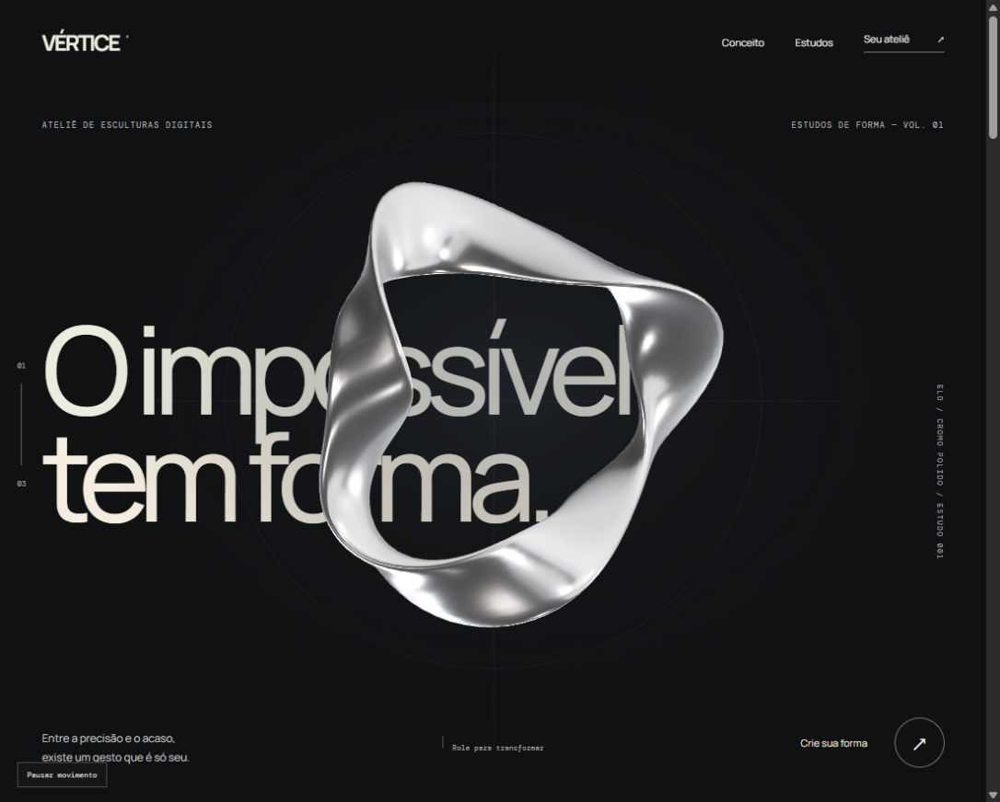

# VÉRTICE — O impossível tem forma.

Um ateliê full-stack de esculturas digitais paramétricas. Uma cena contínua de câmera e luz conduz até um editor real: altere a geometria, guarde uma peça privada, reabra, compartilhe um link de leitura e exporte OBJ.

**[Abrir experiência](https://vertice-studio-gustapaz.starrylinen.chatgpt.site)** · [Como funciona](https://vertice-studio-gustapaz.starrylinen.chatgpt.site/api-docs.html) · [OpenAPI](https://vertice-studio-gustapaz.starrylinen.chatgpt.site/api/openapi.json)



[Vista expandida da estrutura](docs/structure.png)

## Uma solução integrada

- **Frontend:** Omi 7, TypeScript e Babylon.js 9. Web Component para o ateliê, renderização 3D PBR com HDRI local, coreografia de câmera ligada à rolagem nativa, estrutura visível, controles HTML, teclado e movimento reduzido.
- **Backend:** H3 2 e Valibot 1. Geração determinística de geometria, estatísticas e exportação OBJ no servidor. Autorização por recurso, revisão otimista e visibilidade pública explícita.
- **Persistência:** D1/SQLite real com migrações Drizzle. Peças não dependem da memória do processo ou de localStorage. Somente o token de edição da própria peça fica no sessionStorage da aba.
- **Hospedagem:** um Worker, uma origem HTTPS. Vinext serve HTML semântico e API; o frontend Omi é compilado em uma etapa independente. Não há serviço externo pago.

[Contrato entre camadas](docs/solution-contract.md) · [Direção visual](docs/design.md) · [Arquitetura](docs/architecture.md) · [Segurança](docs/security.md) · [Validação](docs/validation.md)

## O que funciona

Três gestos autorais de partida; dobras, torção e tensão alteram vértices reais. Cromo, cobre e cerâmica mudam a apresentação da peça. A API produz uma superfície fechada com 3.072 vértices e 6.144 triângulos, calcula área, volume e bounds e gera OBJ com índices de faces válidos.

Uma peça começa privada. Editar e mudar visibilidade exige token do recurso e revisão esperada; comandos concorrentes não sobrescrevem silenciosamente a revisão vencedora. Links de leitura não contêm token nem permitem editar. O visitante pode criar uma cópia própria. Exportação usa a última revisão salva e contém geometria sem material MTL.

O arquivo da aba permite reabrir até 12 acessos guardados. Fechar a sessão da aba pode perder essas credenciais. Não existe recuperação por conta ou senha. Peças expiram em 7 dias; limpeza física é oportunística em novas criações. Use apenas estudos sintéticos.

## Executar localmente

Node.js 24, npm e um terminal. Nenhuma conta, cartão, senha ou segredo é necessário localmente.

```sh
npm ci
npm test
npm run typecheck
npm run check
npm run build
npm run db:migrate
npm start -- --port 5240
```

Abra http://127.0.0.1:5240. O mesmo servidor atende frontend e backend. `npm run dev:front` serve apenas o bundle de interface para desenvolvimento, não substitui o Worker integrado. Para alterações completas, repita build e reinicie o servidor. Migrações aplicadas são imutáveis; gere uma migração adicional com `npm run db:generate` quando houver mudança de schema.

```sh
npm run smoke -- http://127.0.0.1:5240
```

O smoke cria uma peça sintética, altera, verifica conflito, publica, lê sem token, exporta, retira visibilidade e exclui somente a peça que ele mesmo criou. Não existe reset público ou seed que apague dados existentes.

## API

`GET /api/catalog`, `POST /api/mesh`, `POST /api/pieces`, `GET|PUT|DELETE /api/pieces/:id`, `POST /api/pieces/:id/publish`, `GET /api/pieces/:id/mesh.obj`, `GET /api/health`, `GET /api/openapi.json`.

Parâmetros: `folds` inteiro 3–9, `torsion` inteiro 0–4, `tension` inteiro 0–100, `finish` chrome/copper/ceramic. Título 1–48 caracteres após trim. Datas em Unix seconds UTC; geometria em unidades artísticas, sem escala física.

## Limites concretos

- JSON até 16 KiB, resolução fixa e trabalho limitado por requisição.
- Até 12 criações por hora UTC globalmente; 30 revisões por peça, incluindo mudanças de visibilidade. Essa cota não é proteção DDoS.
- Token aleatório de 256 bits, digest SHA-256 no banco, TTL de 7 dias. Público significa acessível a qualquer pessoa com o link enquanto a peça existir.
- Sem WebGL, há poster estático da peça inicial; métricas, salvamento e OBJ continuam pelo servidor. O poster não acompanha alterações. Fontes, foto e HDRI ficam locais, sem chamadas de assets a terceiros em runtime.
- Não é CAD industrial, engenharia de materiais ou especificação de fabricação. Área e volume são aproximações trianguladas. Nenhum pagamento, envio, fabricação ou integração de terceiros é executado ou simulado como real.
- Hospedagem gratuita via Sites/Cloudflare Workers/D1, sujeita à disponibilidade e às cotas do serviço. Sem cartão, trial, faturamento ou promessa de SLA/gratuidade permanente.

## Créditos e licença

Código e esculturas originais: MIT — Gustavo Paz. A identidade não tem vínculo com Apple ou Rockstar; as referências orientaram apresentação, sem reutilizar seus assets ou marcas.

Fotografia real: Adrien Olichon/Pexels. Ambiente de estúdio: Sergej Majboroda/Poly Haven, CC0. Fontes Manrope e DM Mono distribuídas localmente. Origem, licença, transformações e hashes: [assets](docs/assets.json), [licenças dos assets](docs/assets-license.md), [terceiros](docs/third-party.md) e `vendor/`.
